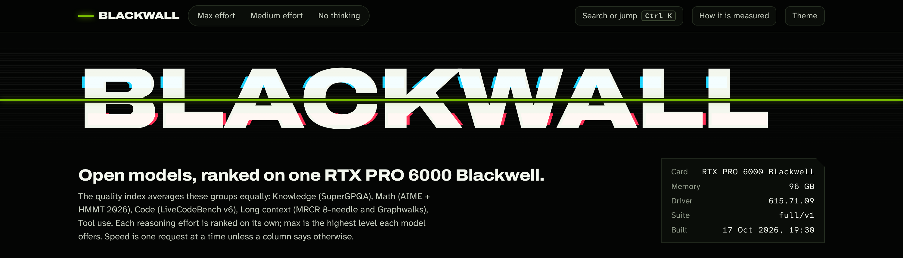
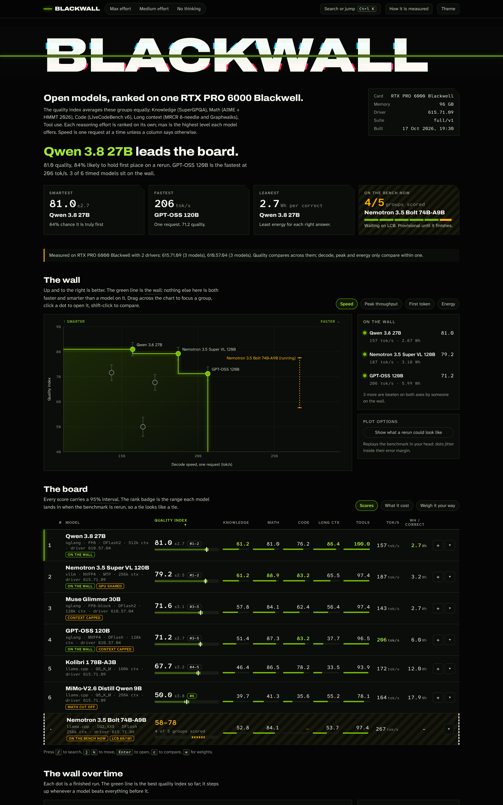

<p align="center">
  
</p>

<p align="center">
  <a href="https://github.com/guitaripod/blackwall/actions/workflows/tests.yml"></a>
  <a href="https://guitaripod.github.io/blackwall/"></a>
  <a href="https://github.com/guitaripod/blackwall/releases/latest"></a>
  
  <a href="LICENSE"></a>
</p>

Blackwall ranks open models on one NVIDIA RTX PRO 6000 Blackwell. It measures every model [llama-swap](https://github.com/mostlygeek/llama-swap) serves from the card, speed and answer quality, the same way each time, and builds one leaderboard from the results.

```
blackwall run gpt-oss-120b
```

Ninety-six gigabytes is a different place from a 24 GB gaming card: gpt-oss-120b fits at MXFP4, a 27B fits at 512k of context, and the question becomes which of them is worth the watts. That question only has an answer when every number comes off the same hardware, so Blackwall is built around one card instead of ranking every GPU. It runs on any NVIDIA GPU llama-swap can serve; the board labels each row with the card it came from and never compares speed across cards.

One command per model: Blackwall loads it through llama-swap, checks the server, measures, stores everything in SQLite and rebuilds a self-contained page. The run lives in a systemd user unit, so closing the terminal only detaches you, and `blackwall resume` continues from the last saved answer. It measures the model as your server actually runs it (quantization, chat template, tool-call parser, speculative decoding, context window), not the weights in a vacuum.



## What comes out

<!--LEADERBOARD-->
| Model | Quality | SuperGPQA | Math | LCB | MRCR | Graphwalks | Tools | tok/s | Peak | TTFT 32k | Wh/correct | Run |
|---|--:|--:|--:|--:|--:|--:|--:|--:|--:|--:|--:|--:|
| Qwen 3.8 27B · SGLang · DFlash2 · 524K | 81.0 | 61.2 | 81.0 | 76.2 | 78.4 | 94.5 | 100.0 | 157 | 400 | 5.0 | 2.67 | 12 Sep |
| Nemotron 3.5 Super VL 120B · vLLM · NVFP4 · MTP | 79.2 | 61.2 | 88.9 | 83.2 | 32.8 | 98.1 | 97.4 | 187 | 414 | 2.4 | 3.18 | 17 Oct |
| Muse Glimmer 30B · SGLang · FP8 · DFlash2 · 128K | 71.6 | 57.8 | 84.1 | 62.4 | 33.9 | 78.8 | 97.4 | 143 | 680 | 4.0 | 2.73 | 13 Sep |
| GPT-OSS 120B · SGLang · MXFP4 · DFlash · 128K | 71.2 | 51.4 | 87.3 | 83.2 | 11.0 | 64.4 | 96.5 | 206 | 432 | 1.8 | 5.99 | 12 Sep |
| Kolibri 1 78B-A3B · llama.cpp · Q5_K_M · 160k | 67.7 | 46.4 | 86.5 | 78.2 | 13.6 | 53.3 | 93.9 | 172 | 470 | 7.9 | 12.00 | 10 Oct |
| MiMo-V2.6 Distill Qwen 9B · llama.cpp · Q5_K_M · 262k | 50.0 | 39.7 | 41.3 | 35.6 | 34.3 | 76.2 | 78.1 | 164 | 419 | 3.8 | 17.92 | 25 Sep |

_6 models on 2 setups, suite full/v1, max effort, newest run 17 Oct 2026._

_tok/s, Peak and Wh/correct come from 2 drivers on one NVIDIA RTX PRO 6000 Blackwell Workstation Edition: 615.71.09 (3 models), 610.57.04 (3 models). They only compare within one_
<!--/LEADERBOARD-->

Quality is the index; then one column per task, single-request decode speed, peak throughput across all requests, first-token wait on a 32k prompt, and board watt-hours per correct answer. The [live page](https://guitaripod.github.io/blackwall/) adds 95% intervals, per-length breakdowns and every server setting behind each run.

The page reads at three depths. A sentence and three cards say who leads, who is fastest and who is leanest. *The wall* plots quality against speed (or first token, or energy) with the frontier drawn through it, and *The board* ranks every model with a rank range such as `#1–2`, because two scores inside each other's intervals are a tie. *Weigh it your way* re-ranks the board and moves the chart as you change the weight of each group, with the default rank shown beside yours. Open a row for what the model is strong and weak at, the scores inside each task, how it behaves, and the data checks and command behind its run; pin up to four models for a head-to-head that calls a difference only when its interval clears zero. A run still in progress sits at the foot of the table with the span its index can still land in. `Ctrl K` searches everything, and the address follows the page, so a link shares the exact view. Those are one card's numbers; a different card, quantization or server setting will move them.

## Following the board

The site is republished whenever new results land, and the same results come three ways, so you can follow them however you like:

- **Atom feed.** [`feed.xml`](https://guitaripod.github.io/blackwall/feed.xml) has one entry per finished run, marked *new best* or *debut*. Add it to any feed reader.
- **Data.** [`board.json`](https://guitaripod.github.io/blackwall/board.json) holds every number on the page plus a `history` of all finished runs, under a `schema` number whose keys are only ever added. [docs/data.md](docs/data.md) describes it.
- **The software.** [Releases](https://github.com/guitaripod/blackwall/releases) list what changed in Blackwall itself, and the [changelog](CHANGELOG.md) keeps the same notes. A change to how scores are computed bumps the suite version, so old and new results are never ranked together.

On the page, *The wall over time* charts the best quality index so far against the date each run finished, and *Recent results* says what each new run changed. `index.html#gpt-oss-120b` opens the page on a model, and the address carries the rest of the view once you change it.

To publish a board of your own, `blackwall export --out site --site-url https://you.example/bench/` writes the page, the data and the feed.

## What a run measures

| Task | Full suite | Scored by |
|---|---|---|
| Speed | 3 prompts × 3 repeats at 1,024 tokens; 1 up to 32 requests at once, as many as the server takes; first-token wait and decode speed from 1k to 250k-token prompts; GPU power | greedy decoding, streamed timings, `nvidia-smi` |
| SuperGPQA | 521 graduate-level questions, ten options, spread over its 13 disciplines like the full set | final `Answer: X` line |
| AIME + HMMT 2026 | 63 problems × 2 samples, 64k-token budget | last `\boxed{}`, compared symbolically with [Math-Verify](https://github.com/huggingface/Math-Verify) |
| LiveCodeBench v6 | 101 problems (Jan–Apr 2025), 64k-token budget | hidden tests, run in a network-less Docker container |
| MRCR, 8 needles | 60 conversations, 15 each at 16k, 32k, 64k and 128k tokens | OpenAI's grade: the requested prefix, then the difflib ratio |
| Graphwalks | 48 graphs, BFS and parent queries from 8k to 64k tokens | F1 of the node set on the last line |
| Tool use | 38 episodes × 3 against a simulated workspace: chained calls, error recovery, clarifying questions, look-alike tools, refund policy, conditionals, follow-ups | the workspace's end state and the reply, not the exact calls |

The quality index averages five groups equally: knowledge, math, code, long context (MRCR and Graphwalks) and tool use. It appears once every task has run, and its 95% interval bootstraps the questions of every task. Each reasoning effort is ranked on its own, so a model's max-effort run sits beside its everyday medium one, and `--effort none` ranks a model with thinking switched off. `--quick` (45–90 minutes, ranked as provisional) and `--smoke` (a pipeline check, never ranked) run smaller samples.

### Why these tasks

MMLU-Pro, AIME 2025, plain needle-in-a-haystack and single-turn tool calls are the usual picks, and current open models sit within a few points of each other on the first and near 100% on the last two — they no longer separate anything. So: SuperGPQA is harder and much larger, the 2026 competitions postdate most of today's models, MRCR and Graphwalks are the long-context tests the model makers themselves report, and the tool episodes follow the [2026 validity audit of tool-calling benchmarks](https://arxiv.org/abs/2607.02577) — deterministic checks of what the model did to the world, so a different valid route to the same result still passes.

LiveCodeBench has published nothing newer than April 2025, so models trained after mid-2025 may have seen its problems; read that column as an upper bound. `blackwall sources` checks Hugging Face for newer releases and for pinned files that moved.

## Numbers you can trust

- **Fixed inputs.** Datasets are downloaded once and pinned by sha256, question subsets use fixed seeds, and every run records the harness version, the suite version and a fingerprint of the llama-swap command plus the launcher script it calls — edit a launcher and it counts as a new configuration.
- **Fixed conditions.** Speed decodes greedily, so the same prompt yields the same tokens and drafter acceptance stays comparable. Quality uses each model's recommended sampling, because reasoning models degrade at temperature 0. A run waits for other GPU work to finish, and says so on the board if it had to go ahead anyway.
- **One stack per speed number.** Every run records the card, its driver and the build of the server that answered — SGLang's version or the commit of the checkout it runs from, llama.cpp's build string. Quality compares across those; decode, peak and watt-hours only compare within one, so the board says when a ranking spans two setups, and `blackwall doctor` says when the stack moved under a model since its last run.
- **Intervals, not point scores.** Every task carries a 95% interval (Wilson, or the spread of per-question means), and the index bootstraps questions within each task. `blackwall compare` pairs two runs question by question and says which differences survive the noise.
- **A dead server is not a bad score.** When the model server stops answering — it crashed, or the card fell off the bus — the run stops and says so, with the kernel's Xid line if there is one, instead of recording the silence as wrong answers. The card is watched the whole way through, and a run keeps its answers so it continues once the machine is well again.
- **Nothing quietly skipped.** A prompt that doesn't fit the model's context scores zero instead of disappearing, and the board says which task that cost. When the server refuses a request for its length, Blackwall reads the window and prompt size out of the refusal, retries once with a smaller answer budget, then scores zero.
- **Cost as well as speed.** Board energy is integrated across the quality tasks and divided by correct answers, so a fast-but-wasteful model is visible as watt-hours per correct answer.
- **Saturation is flagged.** With three or more models ranked, the board marks any task that isn't separating them — all near the ceiling, all near the floor, or apart by less than the noise.

## Benchmarking a model

You need Linux with systemd user units and an NVIDIA GPU, llama-swap in front of SGLang or llama.cpp, Docker for grading LiveCodeBench, Python 3.12 with [uv](https://docs.astral.sh/uv/), and about 1 GB of disk for the pinned datasets. vLLM speaks the same API but is untested: it doesn't report how many requests it takes at once, so Blackwall sends 4.

```
uv tool install git+https://github.com/guitaripod/blackwall
```

Each [release](https://github.com/guitaripod/blackwall/releases) also carries a wheel. Coming from mbench, the [changelog](CHANGELOG.md#migrating-from-mbench) lists the three `mv` commands, and Blackwall prints them itself while the old directories are still there.

**1. Describe the model.** Blackwall reads its launch command from llama-swap's config; anything that command doesn't say goes in `~/.config/blackwall/models.toml`, keyed by llama-swap model id. `blackwall profile <id>` shows what was resolved and where each value came from.

```toml
[gpt-oss-120b]
thinking = "openai"
efforts = ["low", "medium", "high"]
context = 131072
hf_id = "openai/gpt-oss-120b"
quantization = "MXFP4"
spec = { method = "EAGLE3", draft = "lmsys/EAGLE3-gpt-oss-120b-bf16", tokens_per_step = 3 }
```

- `thinking` is how the model takes a reasoning level: `openai` sends `reasoning_effort`, `qwen` sends `chat_template_kwargs` with `enable_thinking` and `reasoning_effort`, `muse` sends `chat_template_kwargs` with `reasoning_strength`, `nemotron` sends `chat_template_kwargs` with `enable_thinking` and, at medium, `medium_effort`, `none` sends nothing.
- `efforts` lists the levels the chat template accepts, lowest first; `--effort max`/`min` pick the ends.
- `context` caps the long-prompt tests. Without it, Blackwall asks the server once the model is loaded.
- `hf_id`, `quantization`, `spec` and `engine` only matter for `--submit`.
- [Oh My Pi](https://github.com/can1357/oh-my-pi) users: `compat.thinkingFormat`, `thinking.efforts` and `contextWindow` are read from its `models.yml` too; `models.toml` wins.

**2. Check the server.** `blackwall doctor <id>` loads the model and verifies tokens per request, how many questions the server lets run at a time, reasoning kept apart from the answer, structured tool calls, a conversation carrying a tool result, and a 16k-token prompt. That number sets how long a run takes: with `--kv-unified`, llama.cpp's `--ctx-size` is one pool every slot shares, and a pool too small for two answers side by side runs every question alone.

**3. Run it.** `blackwall run <id> --effort max`, or `blackwall run <a> <b> --at 02:00 --until 09:00` for a nightly window. Extra models queue and run one at a time. Answers are written as they arrive, so a pause costs nothing, and the local page rebuilds when the run ends.

**4. Read it.** `blackwall ls --effort max` in the terminal, `blackwall board --open` for the page, `blackwall compare <a> <b>` when two models look close and you want to know whether the gap is real. The table shows the scores or what running them cost, whichever tab you pick. Its share links open a 1200 × 675 card you can download as a PNG: *share this table ↗* ranks everything in the tab, *share this ↗* profiles one model, and *share a comparison ↗* sets two models against each other with ties greyed out. Opened with nothing asked of it, the card is the wall: the name, who leads, the fastest and the leanest, and quality against speed with the frontier drawn through it. That is the image link previews show.

**5. Publish it.** `scripts/publish.sh max` exports the page, `board.json` and `feed.xml` into `site/`, re-renders the banner, the leaderboard and the share card, and rewrites the table above between its markers. It addresses the feed to `SITE_URL`, which defaults to this project's own site, so set it for a board of your own. Commit and push: the `pages` workflow redeploys on any change under `site/`. The database is the record; the page, the JSON, the feed and that table are all projections of it, so nothing is typed by hand.

A model only joins an existing ranking if it ran at the same effort level, and changing the question set means bumping the suite version so old and new runs are ranked apart rather than mixed.

### Every command

```
blackwall run <id>                    full suite at medium effort
blackwall run <id> --effort max       the model's highest declared effort, ranked separately
blackwall run <id> --quick --detach   smaller samples; start and return at once
blackwall run <id> --only speed       one task; --skip leaves tasks out
blackwall run <id> --reuse            carry over answers that still apply
blackwall run <a> <b> --at 03:00 --until 08:00
                                      several models, one after another, only at night
blackwall run <id> --submit           also submit to localmaxxing (all, speed or evals)
blackwall status                      what is running, how long its task has left, what is scheduled
blackwall wait [<run>]                block until a run finishes, however often it gives way
blackwall logs -f                     follow the worker log
blackwall cancel · blackwall resume   stop a run; continue it later
blackwall ls [--effort max] [--markdown]
                                      ranked table in the terminal
blackwall compare <a> <b>             paired differences, task by task, with 95% intervals
blackwall doctor <id>                 check a model's server before spending a night on it
blackwall sources                     newer question sets, or pinned files that moved
blackwall board --open                the leaderboard page
blackwall export --out site --site-url URL
                                      the page, board.json and an Atom feed, ready to publish
blackwall profile <id>                what Blackwall knows about a model
blackwall rescore [<run>]             score a finished run again from the answers it kept
blackwall rm <run|model> [--dry-run]  forget runs and everything they measured
```

`blackwall -h` and `blackwall run -h` cover every option.

## Runs that fit around you

A full run takes hours, so it stays out of the way:

- **`--at 03:00 --until 08:00`** runs models one after another inside a nightly window. Whatever is unfinished at 08:00 stops, llama-swap unloads the model, and the run continues from its saved answers the next night. Near the end of a window a run stops taking questions that couldn't finish in time.
- **Runs give way.** When a game or another GPU job holds the card for a minute, the run unloads the model, pauses and retries every ten minutes, whether it was scheduled or started by hand. `--keep-gpu` turns that off.
- **Every run starts with the doctor checks**, so a misconfigured server fails in the first minute instead of producing a night of zeros.
- **The request count matches the server.** Blackwall reads how many requests it accepts at once and how much context they share, then sends many short questions in parallel and long conversations one at a time.
- **`--reuse`** starts a fresh run that keeps the answers of an earlier one for every task whose questions and scoring didn't change, and measures only the rest.
- **Notifications.** Finishing, failing or pausing sends a desktop notification; set `notify` in `~/.config/blackwall/config.toml` (or `BLACKWALL_NOTIFY`) to forward it anywhere, e.g. `notify = 'curl -d "$BLACKWALL_MESSAGE" https://ntfy.sh/your-topic'`.

## Phones

The iPhone harness that came before the RTX PRO 6000 focus is documented in [docs/phone.md](docs/phone.md). Its runs stay in the database and in `blackwall ls --device phone`; the published board does not carry them.

## localmaxxing

`--submit speed` has lmx measure its two canonical prompts, then submits the runs through the [localmaxxing](https://www.localmaxxing.com) API with the prompt hash, output sample and timings the lmx client leaves out, so they earn the Verified badge. `--submit evals` answers the GSM8K and HellaSwag shards the site doesn't have yet for that model and quantization. `--submit` alone does both. Needs `hf_id` and `quantization` in `models.toml`, and [lmx](https://github.com/LottoLottoLotto/localmaxxing-cli) logged in.

## Files

- `~/.local/share/blackwall/bench.db`: runs, metrics and submissions
- `~/.local/share/blackwall/runs/<run>/`: every answer as JSONL (tool episodes with their calls and results), speed samples, the doctor report, server settings, the worker log
- `~/.local/share/blackwall/leaderboard.html`: the local page, rebuilt after every run
- `~/.config/blackwall/models.toml`: model facts · `config.toml`: `notify`, the command that forwards notifications, and `site_url`, the address `export` builds the feed for · `hardware.json`: the card description lmx submits, written on first use
- `~/.cache/blackwall/`: pinned datasets, their token counts and the LiveCodeBench harness

Environment overrides: `BLACKWALL_HOME`, `BLACKWALL_SWAP_URL` (default `http://127.0.0.1:8081`), `BLACKWALL_SWAP_CONFIG`, `BLACKWALL_OMP_MODELS`, `BLACKWALL_NOTIFY`, `XDG_CONFIG_HOME`, `XDG_CACHE_HOME`.

## The name

Blackwall is Blackwell with one letter changed, and a nod to the barrier in *Cyberpunk 2077* that keeps the rogue AIs out of the Net. Here the models run behind the wall and the leaderboard is what comes back. The green line through the quality-against-speed chart is the wall too: it joins the models nothing else beats on both.

Blackwall is an independent project and is not affiliated with or endorsed by NVIDIA or CD PROJEKT RED. NVIDIA, RTX and Blackwell are trademarks of NVIDIA Corporation; *Cyberpunk 2077* is a trademark of CD PROJEKT S.A. 
## Credits

Questions come from [SuperGPQA](https://huggingface.co/datasets/m-a-p/SuperGPQA) (ODC-BY), [MathArena's AIME 2026 and HMMT February 2026](https://matharena.ai) (CC BY-NC-SA 4.0), [LiveCodeBench](https://livecodebench.github.io), and OpenAI's [MRCR](https://huggingface.co/datasets/openai/mrcr) and [Graphwalks](https://huggingface.co/datasets/openai/graphwalks) (MIT) — downloaded at run time, never redistributed. Code grading uses LiveCodeBench's own harness at a pinned commit. The long speed prompts are built from MMLU-Pro question text; the two canonical speed prompts are localmaxxing's.

## Development

```
uv run --group dev pytest
uv tool install --editable .
scripts/publish.sh max         # site/, docs/*.png and the table above
```

To release: set `__version__` in `blackwall/__init__.py`, write the version's section in `CHANGELOG.md`, run `scripts/publish.sh max`, commit and push, then `git tag -a X.Y.Z -m "Blackwall X.Y.Z" && git push origin X.Y.Z`. The `release` workflow checks the tag against the version, runs the tests, builds the wheel and sdist, and publishes the release with that section as its notes. Tags have no `v`.

Licensed under GPL-3.0-or-later.
